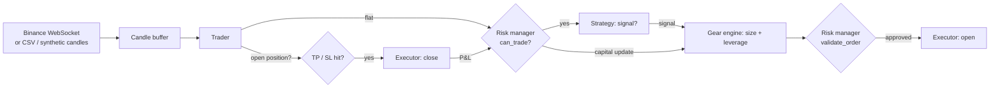

# Trading Bot


A crypto futures trading bot for Binance, built around one idea: **risk settings should change as the account grows**.
A £50 account and a £50k account shouldn't trade the same way, so a "gear engine" moves the bot through capital tiers. Each tier changes leverage, position size and which strategies are allowed. Underneath it all is a risk layer that every order must pass.

Paper trading, live trading and backtesting all run through the **same `Trader` class**, so a backtest exercises the exact code path that would place a real order.

```bash
pip install -r requirements.txt
python main.py --mode backtest          # runs offline in about a second, no API keys needed
```

---

## How it works



On each closed one-minute candle:

1. **If a position is open**, check this candle's high and low against take-profit and stop-loss. If a single candle touches both, the bot assumes the stop filled first, which is the pessimistic assumption.
2. **If flat**, the risk manager decides whether trading is allowed at all. Then the strategy looks for a signal, the gear engine sizes it, and the risk manager caps it.
3. **Closed trades feed back** into capital. Capital decides the gear, and the gear sets the next trade's limits.

### Gear engine: risk that scales with capital

| Gear | Capital | Max leverage | Max position | Daily loss stop | Strategies unlocked |
|---|---|---|---|---|---|
| G1 | < 200 | 15x | 35% | 15% | scalping |
| G2 | 200 – 1k | 10x | 30% | 12% | + momentum |
| G3 | 1k – 5k | 7x | 25% | 10% | + funding-rate harvest |
| G4 | 5k – 20k | 4x | 20% | 8% | momentum, funding, stat-arb |
| G5 | 20k – 100k | 2x | 15% | 6% | + cross-exchange arb |
| G6 | 100k+ | 1x | 10% | 5% | funding, stat-arb, arb |

Gears shift both ways. A drawdown that drops capital below a threshold moves the bot down a gear, which automatically cuts its leverage.

### Circuit breakers (`risk/risk_manager.py`)

These sit above every gear and can't be overridden by a signal:

| Rule | Effect |
|---|---|
| 30% drawdown from peak | **Full halt.** No more trading until a human intervenes. |
| 10% loss in a day | No new trades until the next UTC day |
| 15x leverage | Hard cap, whatever the gear or signal asks for |
| Position < 5 | Rejected, because fees and exchange minimums dominate below this |

### G1 strategy: momentum scalper (`strategies/scalping.py`)

- EMA(9) crossing EMA(21) gives the direction
- RSI(14) filter: no longs above 65, no shorts below 35
- Volume must be at least 1.5x the recent average
- Take-profit 0.4%, stop-loss 0.2% (2:1 reward to risk)

Fees (0.05% taker per side) and P&L are both calculated on **notional** (margin × leverage), which is what the exchange actually charges.

---

## Backtesting

```bash
# Offline: a seeded random walk with volatility regimes (reproducible)
python main.py --mode backtest --candles 20000 --seed 42

# Real data: pull candles from Binance's public API (no key needed), then replay them
python scripts/fetch_klines.py --symbol BTCUSDT --days 30 --out history/btcusdt_1m.csv
python main.py --mode backtest --data history/btcusdt_1m.csv --capital 50
```

```
========================================================
  BACKTEST REPORT
========================================================
  Period          2026-09-22 07:28 → 2026-10-22 07:27 UTC
  Candles         43,200
  Capital         50.00 → 34.59  (-30.8%)
  Peak capital    50.00
  Max drawdown    30.8%
--------------------------------------------------------
  Trades          49
  Win rate        26.5%
  Avg win / loss  +0.68 / -0.67
  Profit factor   0.36
  Gear shifts     0
  CIRCUIT BREAKER Max drawdown breached: 30.8%
========================================================
```

### What the backtester has shown so far

That run is 30 days of real BTC/USDT one-minute candles, and it's the reason the backtester exists:

- **The G1 scalper has no edge as it stands.** The 2:1 reward-to-risk looks good on paper, but round-trip fees (0.1% of notional) take a quarter of every win and make every loss 50% bigger. After costs it's really 1:1, so it needs a 50%+ win rate. It got ~25%.
- **The risk layer did its job.** The circuit breaker stopped the account at the 30% line instead of letting it run to zero.
- **Next:** test on 5m/15m candles (fewer trades, so fees take a smaller share), add a trend filter, and run walk-forward tests before anything touches real money.

---

## Running it

```bash
python main.py --mode paper     # live Binance candles, simulated fills
python main.py --mode live      # real orders: needs BINANCE_API_KEY / BINANCE_API_SECRET in .env
pytest -q                       # 29 tests: gear shifts, circuit breakers, fills, TP/SL exits, backtests
```

Live mode is wired up through ccxt (USD-M futures, sets leverage, sizes in base currency, reduce-only closes), but treat it as experimental. Use a key with withdrawals disabled.

## Layout

```
core/          gear_engine.py (capital tiers), trader.py (the loop shared by all modes)
risk/          risk_manager.py: circuit breakers, order validation
strategies/    scalping.py (G1), funding_rate.py (delta-neutral funding harvest, not yet wired in)
execution/     binance_executor.py: paper fills and live ccxt orders, P&L on notional
data/          binance_feed.py (WebSocket with reconnects), candle_buffer.py
backtesting/   engine.py (replay + metrics), data.py (CSV loader, synthetic candles)
scripts/       fetch_klines.py: download historical candles
tests/         pytest suite, run in CI on every push
```

## Roadmap

- [x] Gear engine, risk manager, paper executor
- [x] Live Binance feed with auto-reconnect
- [x] TP/SL exit management; trades feed back into capital and gears
- [x] Backtester sharing the live code path, synthetic + real data
- [ ] Higher-timeframe and trend-filtered variants of the scalper
- [ ] Walk-forward validation and parameter sweeps
- [ ] Wire the funding-rate harvester into G3+
- [ ] Persist trades to SQLite and a small P&L dashboard

*Not financial advice. Leveraged crypto trading can lose you more than you expect, faster than you expect.*
